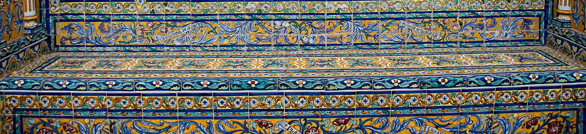

# Design System: Tablero · Paño de azulejos

Documento de dirección de arte para la rama `feat/identidad-visual`. Manda el enunciado del profesor (al principio del `README.md`); este documento solo cambia el aspecto y no quita nada de lo que el enunciado pide ni de lo que ya funciona.

> **La idea.** En esta página, la azulejería sevillana (Triana, Plaza de España) se convierte en el tablero: cada ficha es un azulejo, el tablero es un paño de pared y, al completar una fila, esa fila se convierte en una cenefa.

Lectura del encargo: es una aplicación, no una landing. La pantalla tiene que dejar jugar en cuanto carga, así que el tablero domina la primera vista en todos los anchos. La identidad sale del material (vidriado, cuerda seca, juntas, cenefas) y de una sola fotografía real, no de adornos.

---

## 1. Concepto

### 1.1 Inventario del tema

Cosas que pertenecen a este proyecto (una práctica de la Universidad de Sevilla) y a ningún otro juego de fichas:

1. **Blanco de estaño.** El esmalte estannífero es el fondo de casi todo azulejo sevillano. Es el color de la celda.
2. **Azul cobalto.** El óxido de cobalto da el azul profundo de los filetes y marcos de la Plaza de España. Es el color de la acción.
3. **Ocre melado.** El amarillo de antimonio y el melado de hierro llenan el fondo de las cenefas del banco de Cáceres (la foto). Es el color de la ayuda y del logro.
4. **Verde de cobre, almagra y manganeso.** El resto de la paleta de esmaltes; con el cobalto y el ocre dan los seis colores de ficha.
5. **Cuerda seca.** La técnica separa los esmaltes con una línea de manganeso. Aquí es el contorno oscuro de cada motivo, y es lo que mantiene el contraste de las fichas claras.
6. **La junta (llaga).** El hueco entre piezas. En el tablero son los huecos de la rejilla; la horizontal es más ancha porque el juego va por filas.
7. **El paño.** Un tramo de pared alicatado y enmarcado en cobalto. Es el marco del tablero.
8. **La cenefa.** El friso de piezas que repiten un motivo y enlazan sus dibujos de una pieza a la siguiente. Es la fila completa.
9. **La estrella de lazo.** La estrella de ocho puntas de la lacería mudéjar (alicatados del Alcázar, Cartuja). Sustituye a la estrella de cinco puntas.
10. **La cartela.** El rótulo enmarcado con el nombre de cada provincia en los bancos de la Plaza de España ("CACERES" en la foto). Es el modelo de la tarjeta de victoria y de los diálogos.
11. **El zócalo.** La franja de azulejo de la parte baja de un muro. Es el papel de la fotografía en la página.
12. **Letra romana de rótulo.** Las cartelas usan capitales y minúsculas romanas con remate. Es la razón de que los títulos vayan en una serifa antigua del sistema.

Prueba del competidor: si se cambia "azulejería sevillana" por "un juego de fichas cualquiera", la frase deja de funcionar. Las juntas, la cuerda seca y la cenefa solo tienen sentido con este material, y la foto es de un banco concreto de Sevilla.

**Lo vivo** de la página es el propio juego. La idea se ve al jugar: cuando una fila queda de un solo tipo, sus azulejos cambian de vidriado y enlazan sus esquinas en una cenefa.

### 1.2 Argumento de la pantalla

| Afirmación | Prueba en pantalla |
|---|---|
| Esto es un juego de fichas que se ordena por filas | Título grande y lema; tablero en el centro de la primera vista |
| Las fichas son azulejos de Sevilla | Celdas de blanco estaño con juntas, motivos con cuerda seca, foto real del zócalo |
| Se juega ya, con ratón, dedo o teclado | Barra de acciones bajo el tablero; instrucciones a 16 px en tinta plena |
| Completar una fila se nota | La fila pasa a cenefa: fondo ocre, esquinas de cobalto enlazadas y ✓ |
| Se puede personalizar | Panel de ajustes con muestras que son azulejos de verdad |

### 1.3 Auditoría de lo existente

Sale de aplicar `redesign-existing-projects` y las reglas de `design-taste-frontend` al código actual (`css/*.css`, `index.html`).

| Problema actual | Dónde | Sustitución |
|---|---|---|
| Línea fina bajo la cabecera | `layout.css`, `.cabecera` con `border-block-*: 1px` | Espacio y cambio de escala |
| Panel como tarjeta blanca con borde de 1 px | `.panel__seccion` | Campo de color `--comp-superficie` sin borde (escalón de tono) |
| Etiquetas en mayúsculas espaciadas ("MOVIMIENTOS") | `.marcador__etiqueta` | Cifra grande seguida de la palabra en minúscula: "12 movimientos" |
| Instrucciones y notas a 12,8 px en gris | `.nota`, `.instrucciones` | 16 px; instrucciones en tinta plena y notas en `--comp-texto-suave` (≥ 6:1) |
| Título pequeño (`1rem + 4vw`, tope 2,44 rem) | `--texto-titulo` | Serifa antigua del sistema, de 3,16 rem a 5,6 rem |
| Botón azul genérico (hsl 225 70 % 42 %) | `.boton--principal` | Cobalto profundo hsl(224 62 % 34 %), esquinas casi rectas, sin borde |
| Interfaz monocromática azul pizarra | `--mono-*` | Esquema complementario cobalto/ocre y tablero de azulejo |
| Sin imágenes | — | Foto real del zócalo del banco de Cáceres (Plaza de España) |
| Radios suaves de 8 px y 24 px en todo | `--radio`, `--radio-contenedor` | 2 px en piezas y controles, 4 px en contenedores |
| Bordes de 1 px en botones, segmentado, victoria y diálogos | `components.css` | Rellenos de color; marco grueso de cobalto solo en las cartelas |
| Signo de admiración en "¡Tablero completado!" | `index.html` | "Tablero completado" |

Lo que ya está bien y se conserva: MVC, Drag & Drop con `dataTransfer`, selección por `data-*`, `subgrid`, container queries, FLIP, `@starting-style`, `forced-colors`, `prefers-contrast`, `prefers-reduced-motion`, roles ARIA, foco distinto de la selección, insignia ⇄ con `position`, ✓ de fila y áreas táctiles de 44 px.

---

## 2. Atmósfera

Una pared de azulejos vista de cerca y con luz de día. El tablero es lo único oscuro y saturado de la página: un paño enmarcado en cobalto con piezas blancas. Todo lo demás (cabecera, panel, textos) es blanco estaño y tinta azul, sin adorno, para que la cerámica sea lo que se mira.

- **Densidad 4/10** (aplicación equilibrada): mucho aire alrededor del tablero, panel compacto.
- **Variación 4/10**: el tablero va centrado en su columna, que es el único momento centrado; cabecera, panel y textos van alineados a la izquierda.
- **Movimiento 3/10** (estático y contenido): solo se mueve lo que comunica algo (intercambio, cenefa, aparición de capas). Se descartan las animaciones perpetuas que propone la skill de Stitch, que en un juego distraen.

---

## 3. Color

### 3.1 Estrategia

Dos esquemas, cada uno con su prefijo de variable como pide la teoría ("usar nombres de variables según el esquema"):

**Interfaz: complementario cobalto/ocre (`--comp-*`).** Se fija un matiz y su opuesto con la fórmula de la teoría:

```css
--comp-matiz: 224;                               /* azul cobalto */
--comp-opuesto: calc(var(--comp-matiz) + 180);   /* 404 = 44°, ocre melado */
```

Son los dos colores que dominan la Plaza de España (filetes de cobalto sobre fondos ocres) y la foto del zócalo. Cada uno tiene un papel fijo, y así el color también informa:

- **Cobalto = acción.** Botón principal, opción marcada, foco de los controles, selección dentro del tablero.
- **Ocre = ayuda y logro.** Insignia y anillo de la pista, destino del arrastre, ✓ de fila y fondo de la cenefa.
- Los neutros no son grises: el fondo y las superficies son el opuesto (44°) casi sin saturación (blanco estaño) y la tinta es el matiz (224°) muy oscuro. Por eso los grises no mezclan temperaturas.

**Fichas: dos tríadas de esmaltes intercaladas (`--triada-*`).** La teoría del curso no recoge el hexádico, así que las seis fichas se plantean como dos tríadas, la segunda girada 60° respecto a la primera. Entre las dos dan seis matices a 60° en `oklch`, empezando en el cobalto (265°). Cada matiz cae en un esmalte real de la azulejería. Por defecto se usa una sola tríada (tonos 1, 3 y 5); la otra solo aparece si el jugador cambia los colores:

| Clave | Matiz oklch | Esmalte | Nombre visible |
|---|---|---|---|
| `tono-1` | 265 | óxido de cobalto | Cobalto |
| `tono-2` | 325 | óxido de manganeso | Manganeso |
| `tono-3` | 25 (385) | almagra (óxido de hierro rojo) | Almagra |
| `tono-4` | 85 (445) | antimonio / melado | Ocre |
| `tono-5` | 145 (505) | óxido de cobre | Verde |
| `tono-6` | 205 (565) | cobre en base alcalina | Turquesa |

El esquema anterior tenía la misma luz en las seis fichas porque el tablero era oscuro. Ahora el fondo de la celda es blanco y cada esmalte tiene su luz propia, como en la cerámica. Eso añade un tercer canal: en escala de grises las fichas también se distinguen por lo claras u oscuras que son (luminancias de 0,08 a 0,51). La forma sigue siendo el canal principal, el color la refuerza y la luz ayuda a quien no distingue matices.

Las fichas claras (ocre, turquesa, verde) no llegan a 3:1 contra el blanco estaño. Por eso cada motivo lleva un contorno de **cuerda seca** de manganeso oscuro, que da más de 10:1 con cualquier fondo de celda. Ese contorno es obligatorio, no decorativo (WCAG 1.4.11).

### 3.2 Tokens de la interfaz

Todos en HSL a partir de `--comp-matiz` y `--comp-opuesto`. La columna "hex" es solo de referencia.

| Token | Claro | Oscuro | Uso |
|---|---|---|---|
| `--comp-fondo` | `hsl(var(--comp-opuesto) 30% 96%)` `#f8f6f2` | `hsl(var(--comp-matiz) 34% 10%)` `#111522` | Fondo de página (blanco estaño / noche cobalto) |
| `--comp-superficie` | `hsl(var(--comp-opuesto) 24% 90%)` `#ece8df` | `hsl(var(--comp-matiz) 28% 15%)` `#1c2131` | Panel, botones secundarios, un escalón de tono |
| `--comp-texto` | `hsl(var(--comp-matiz) 48% 15%)` `#141e39` | `hsl(var(--comp-opuesto) 32% 93%)` `#f3efe7` | Tinta: todo el texto corrido |
| `--comp-texto-suave` | `hsl(var(--comp-matiz) 18% 36%)` `#4b546c` | `hsl(var(--comp-opuesto) 14% 72%)` `#c2bcae` | Notas, lema secundario, crédito |
| `--comp-borde` | `hsl(var(--comp-matiz) 14% 52%)` | igual | Solo bordes de `select` (campo de formulario) |
| `--comp-cobalto` | `hsl(var(--comp-matiz) 62% 34%)` `#213e8c` | `hsl(var(--comp-matiz) 78% 74%)` `#89a5f0` | Botón principal, opción marcada, foco |
| `--comp-cobalto-activo` | `hsl(var(--comp-matiz) 62% 27%)` | `hsl(var(--comp-matiz) 78% 82%)` | Hover y pulsado del principal |
| `--comp-sobre-cobalto` | `hsl(var(--comp-opuesto) 30% 96%)` | `hsl(var(--comp-matiz) 50% 11%)` | Texto sobre cobalto |
| `--comp-melado` | `hsl(var(--comp-opuesto) 78% 60%)` `#e9b949` | igual | Pista, destino, ✓ |
| `--comp-velo` | `hsl(var(--comp-matiz) 50% 8% / 0.55)` | igual | Fondo de diálogos modales |
| `--comp-velo-ligero` | `hsl(var(--comp-matiz) 50% 8% / 0.2)` | igual | Capa de victoria (deja ver el tablero) |
| `--comp-sombra` | `hsl(var(--comp-matiz) 50% 8% / 0.35)` | igual | Solo diálogos y tarjeta de victoria, que flotan |

### 3.3 Tokens del tablero

El azulejo es un objeto físico: en modo oscuro baja un poco su luz para no deslumbrar, pero sigue siendo claro. Los anillos del tablero no usan `light-dark()` porque siempre van sobre azulejo claro o sobre el paño oscuro.

| Token | Claro | Oscuro | Uso |
|---|---|---|---|
| `--pano` | `hsl(var(--comp-matiz) 52% 19%)` `#17254a` | `hsl(var(--comp-matiz) 40% 22%)` `#222e4f` | Fondo del marco: lo que se ve por las juntas |
| `--pano-filete` | `hsl(var(--comp-matiz) 55% 32%)` | `hsl(var(--comp-matiz) 45% 34%)` | Franja de la fila completa (región común) |
| `--azulejo` | `hsl(var(--comp-opuesto) 33% 97%)` `#faf8f5` | `hsl(var(--comp-opuesto) 20% 88%)` `#e7e3da` | Vidriado de la celda en reposo |
| `--azulejo-seleccionado` | `hsl(var(--comp-matiz) 70% 90%)` | `hsl(var(--comp-matiz) 45% 80%)` | Vidriado de la celda elegida |
| `--azulejo-cenefa` | `hsl(var(--comp-opuesto) 80% 86%)` | `hsl(var(--comp-opuesto) 55% 78%)` | Vidriado de las celdas de una fila completa |
| `--azulejo-lazo` | `hsl(var(--comp-matiz) 60% 87%)` | `hsl(var(--comp-matiz) 30% 77%)` | Lazo de las esquinas de cada azulejo, muy por debajo de la ficha |
| `--azulejo-luz` | `hsl(var(--comp-opuesto) 33% 97%)` | igual | Anillo de foco del teclado sobre el paño |
| `--tinta-azulejo` | `hsl(var(--comp-matiz) 62% 30%)` | igual | Anillo de selección, origen discontinuo y esquinas de la cenefa |
| `--cuerda-seca` | `oklch(30% 0.05 330)` (respaldo `hsl(306 25% 19%)`) | igual | Contorno de todos los motivos |

### 3.4 Tokens de las fichas

```css
--triada-matiz: 265;
--triada-1: oklch(47% 0.14 var(--triada-matiz));                 /* cobalto   */
--triada-2: oklch(45% 0.10 calc(var(--triada-matiz) + 60));      /* manganeso */
--triada-3: oklch(57% 0.15 calc(var(--triada-matiz) + 120));     /* almagra   */
--triada-4: oklch(80% 0.13 calc(var(--triada-matiz) + 180));     /* ocre      */
--triada-5: oklch(66% 0.14 calc(var(--triada-matiz) + 240));     /* verde     */
--triada-6: oklch(72% 0.10 calc(var(--triada-matiz) + 300));     /* turquesa  */
```

Respaldo HSL, declarado antes y sustituido dentro de `@supports (color: oklch(0% 0 0))`. Para que el respaldo también sea un esquema de verdad, parte del cobalto de la interfaz y suma 60° cada vez, con la saturación y la luz de cada esmalte: `hsl(var(--comp-matiz) 53% 43%)`, `hsl(calc(var(--comp-matiz) + 60) 29% 35%)` y así hasta `+ 300` (224, 284, 344, 44, 104 y 164°). Por eso no coincide exactamente con los valores oklch, que reparten los 60° en un espacio perceptual. El 224 de HSL y el 265 de oklch son el mismo cobalto expresado en dos espacios de color distintos.

### 3.5 Contrastes comprobados

Calculados con la fórmula WCAG 2.x sobre los valores de arriba.

| Par | Claro | Oscuro | Mínimo |
|---|---|---|---|
| Tinta / fondo | 15,3 | 15,9 | 4,5 |
| Tinta / superficie | 13,5 | 14,0 | 4,5 |
| Texto suave / fondo | 7,0 | 9,6 | 4,5 |
| Texto suave / superficie | 6,2 | 8,4 | 4,5 |
| Borde de `select` / superficie | 3,4 | 3,9 | 3 |
| Texto sobre cobalto / cobalto | 9,2 | 7,5 | 4,5 |
| Azulejo / paño | 14,2 | 10,5 | 3 |
| Melado (pista, ✓) / paño | 8,2 | 7,3 | 3 |
| Melado / filete de fila completa | 5,8 | 5,3 | 3 |
| Foco `--azulejo-luz` / paño | 14,2 | 12,7 | 3 |
| Anillo de selección / vidriado seleccionado | 8,3 | 6,3 | 3 |
| Esquinas de cenefa / vidriado cenefa | 9,2 | 7,7 | 3 |
| Cuerda seca / azulejo | 13,2 | 10,9 | 3 |
| Cuerda seca / vidriado cenefa | 11,4 | 9,6 | 3 |
| Paño (texto ⇄) / melado | 8,2 | 7,6 | 4,5 |

### 3.6 Reglas de color

- Una sola acción en cobalto por grupo: "Nueva partida" en la barra y el botón de aceptar en cada diálogo.
- Nunca negro puro: la tinta más oscura es `#141e39`.
- Sin degradados de fondo. Los únicos `radial-gradient` del proyecto dibujan las esquinas de la cenefa, que forman parte del motivo del azulejo.
- Sin sombras en reposo. Solo llevan `--comp-sombra` los diálogos y la tarjeta de victoria, que flotan sobre la página.

---

## 4. Tipografía

### 4.1 Estrategia: dos fuentes contrastadas

La teoría da dos caminos: dos fuentes contrastadas o una sola con niveles de realce. Se pasa al primero. Los títulos usan una serifa antigua, como la letra de las cartelas de la Plaza de España, y el resto de la interfaz una palo seco del sistema. La serifa da el carácter y la palo seco la lectura en tamaños pequeños; el contraste entre ellas marca la jerarquía (principios de contraste y jerarquía de la teoría). Las dos son pilas de fuentes estándar del sistema ("Utiliza fuentes estándar", "Limita el número de tipos de fuentes"): no se descarga nada.

```css
--fuente-rotulo: "Iowan Old Style", "Palatino Linotype", Palatino, "URW Palladio L", P052, "Book Antiqua", serif;
--fuente-texto: system-ui, -apple-system, "Segoe UI", Roboto, "Noto Sans", Ubuntu, Cantarell, "Helvetica Neue", Arial, sans-serif;
```

Iowan Old Style y Palatino vienen en macOS, Palatino Linotype y Book Antiqua en Windows, y URW Palladio L / P052 (clones de Palatino) en casi todos los Linux con las fuentes base de Ghostscript. Las reglas de la skill de Stitch que prohíben Palatino y piden Geist o Satoshi no se aplican aquí, porque el enunciado y la teoría exigen fuentes estándar.

**Va en serifa (`--fuente-rotulo`):** el `h1`, el título "Ajustes", los títulos de los diálogos y de la victoria, y las cifras del marcador. **Todo lo demás va en palo seco (`--fuente-texto`).**

### 4.2 Escala

Escala modular de razón 4:3 (`--razon: 1.333`, cuarta justa), calculada con `pow()` como ahora. Cinco tamaños como máximo en toda la página:

| Token | Valor | ≈ px | Uso |
|---|---|---|---|
| `--texto-nota` | `0.875rem` | 14 | Notas y crédito de la foto |
| `--texto-normal` | `1rem` | 16 | Todo el texto corrido, notas del panel, botones, instrucciones |
| `--texto-lema` | `calc(1rem * var(--razon))` | 21 | Lema de la cabecera |
| `--texto-destacado` | `calc(1rem * pow(var(--razon), 2))` | 28 | Cifras del marcador, "Ajustes", títulos de diálogos y victoria |
| `--texto-titulo` | `clamp(calc(1rem * pow(var(--razon), 4)), 1rem + 6vw, calc(1rem * pow(var(--razon), 6)))` | 51 a 90 | `h1` |

La ✓ y la ⇄ se dimensionan con la celda (`--celda`) y no cuentan en la escala.

### 4.3 Reglas

- `h1`: peso 400, `letter-spacing: -0.02em`, `line-height: 0.95`. La serifa ya tiene peso visual de sobra; en negrita Palatino se emborrona.
- Títulos de nivel 2 en serifa: peso 600, `line-height: 1.1`.
- Texto: 16 px, peso 400, `line-height: 1.5`, `max-inline-size: 60ch` (teoría: unos 60 caracteres por línea).
- Botones y mensajes de estado: peso 600.
- Cifras del marcador: `font-variant-numeric: lining-nums tabular-nums`, para que no bailen al cambiar.
- Ninguna etiqueta en mayúsculas ni con espaciado positivo. Se elimina `--espaciado-mayusculas`.
- `text-wrap: balance` en títulos y `pretty` en párrafos (ya existe).
- Ninguna palabra destacada con otro color, cursiva o fuente dentro de un título.

---

## 5. Espacio

### 5.1 Unidades y escala

- `rem` para todo lo tipográfico y de interfaz; `cqi` para ajustar la celda al ancho del contenedor; `%` dentro de la ficha.
- Escala doble de espaciado, la de ahora: `--espacio-2: 0.5rem`, `--espacio-3: 1rem`, `--espacio-4: 2rem`. Se añade `--espacio-1: 0.25rem` para las juntas del control segmentado.
- **Radios.** Se abandona el radio concéntrico (8 + 16 px) porque redondeaba demasiado. Un azulejo tiene la arista casi viva: `--radio-azulejo: 0.125rem` (2 px) en celdas, botones, campos y segmentado; `--radio-contenedor: 0.25rem` (4 px) en el marco, el panel, los diálogos y la cartela de victoria. La foto va sin redondear.
- Se mantienen `--objetivo-minimo: 2.75rem`, `--medida: 60ch`, `--medida-caja: 34rem`, `--ancho-pagina: 78rem` y `--ancho-panel: 22rem`.

### 5.2 Geometría del paño

Se mantiene la fórmula de la celda y del tablero (`subgrid`, medias columnas, `cqi`):

- Celdas: `--celda-pequena: 2.75rem`, `--celda-mediana: 3.75rem`, `--celda-grande: 5rem`.
- Junta vertical: `--hueco-columna: 0.06` de la celda. Junta horizontal: `--hueco-fila: 0.18`. En un paño real las juntas son iguales; aquí la horizontal es tres veces más ancha a propósito, porque el juego se lee por filas.
- Ficha: `--ficha-proporcion: 76%` de la celda.
- Marco: relleno `--relleno-marco` (`--espacio-3`), fondo `--pano`, sin borde. En modo oscuro el paño se separa del fondo por un escalón de tono (L 22 % frente a 10 %) y por el blanco de las piezas.
- Medias columnas: `--media: 0.5` de la celda. Cuando el área de juego mide menos de 26 rem (`@container juego`), el marco pasa a `--espacio-2` de relleno y las medias columnas a `0.35`. La fórmula de la celda descuenta ese relleno y esas medias (`N + 2 · media + (N + 1) · junta`), así que el ancho recuperado va a las fichas: en un 9 × 9 a 320 px la celda pasa de unos 21 px a 23,5 px. El centrado y la ✓ no cambian.

### 5.3 Gestalt

- **Figura y fondo:** azulejos blancos sobre el paño de cobalto. Cada azulejo lleva en sus cuatro esquinas un lazo de cobalto muy pálido (un punto y un cuarto de anillo), que da textura de cerámica y queda claramente por debajo de la ficha.
- **Proximidad:** juntas horizontales más anchas que las verticales; las filas se leen como unidades.
- **Semejanza:** mismo tipo, misma forma, color y luz.
- **Región común:** la fila completa se apoya en una franja `--pano-filete`; el panel es un campo de color; la cartela de victoria va enmarcada.
- **Cierre y continuidad:** los lazos de cuatro piezas vecinas se leen como una roseta partida por las juntas, como en los azulejos de cuenca. En la cenefa el lazo desaparece y cada azulejo dibuja un cuarto de círculo de cobalto intenso en cada esquina. Los cuartos de dos piezas vecinas se leen como un círculo entero a través de la junta, y la fila se lee como un friso continuo. Así funcionan los azulejos de repetición reales.

---

## 6. Componentes

### 6.1 El azulejo (celda)

Cuadrado de vidriado con arista casi viva (`--radio-azulejo`). El color de fondo sale de una variable, `--vidriado`, que cambia con el estado. La ficha la hereda para pintar el "ojo" del motivo del mismo color que la pieza. Encima del vidriado van cuatro `radial-gradient`, uno por esquina, que dibujan el lazo; sus radios se miden con `--celda`, de modo que el motivo crece y mengua con el azulejo.

```css
.celda {
  --vidriado: var(--azulejo);
  --anillo-dentro: 0px;
  --anillo-fuera: 0px;
  position: relative;               /* referencia de la insignia ⇄ y de las esquinas de cenefa */
  display: grid;
  place-items: center;
  --lazo: var(--azulejo-lazo) calc(var(--celda) * 0.07), transparent 0 calc(var(--celda) * 0.11),
    var(--azulejo-lazo) 0 calc(var(--celda) * 0.17), transparent 0;
  background-color: var(--vidriado);
  background-image:
    radial-gradient(circle at 0 0, var(--lazo)),
    radial-gradient(circle at 100% 0, var(--lazo)),
    radial-gradient(circle at 0 100%, var(--lazo)),
    radial-gradient(circle at 100% 100%, var(--lazo));
  border-radius: var(--radio-azulejo);
  box-shadow:
    inset 0 0 0 var(--anillo-dentro) var(--tinta-azulejo),
    0 0 0 var(--anillo-fuera) var(--comp-melado);
  /* cursor, user-select, touch-action y draggable: como ahora */
}
```

Matriz de estados. Cada estado cambia algo más que el color:

| Estado | Clase o selector | Vidriado | Anillo | Ficha | Extra |
|---|---|---|---|---|---|
| Reposo | — | `--azulejo` | — | escala 1 | — |
| Hover (solo `hover: hover`) | `:hover` | igual | — | escala 1,08 | — |
| Foco de teclado | `:focus-visible` | igual | `outline: var(--anillo) solid var(--azulejo-luz)`, `outline-offset: 2px` (por fuera, sobre el paño) | igual | `z-index: var(--capa-celda)` |
| Seleccionada | `.celda--seleccionada` | `--azulejo-seleccionado` | interior 3 px `--tinta-azulejo` | escala 1,15 | — |
| Mismo tipo que la elegida | `.celda--igual` | igual | — | `opacity: 0.35` | — |
| Pista | `.celda--pista` | igual | exterior 3 px `--comp-melado` | igual | insignia ⇄ |
| Destino del arrastre | `.celda--destino` | igual | exterior 3 px `--comp-melado` | igual | insignia ⇄ |
| Origen del arrastre | `.celda--origen` | igual | `outline: 2px dashed var(--tinta-azulejo)`, `outline-offset: calc(-2 * var(--anillo))` | `opacity: 0.35` | — |
| Fila completa | `.celda--completa` | `--azulejo-cenefa`, sin lazo | — | igual | esquinas de cenefa (6.4) |

El foco es blanco y por fuera, la selección es cobalto y por dentro con cambio de vidriado, y la pista es ocre por fuera con insignia. Los tres se pueden combinar sin reglas especiales gracias a `--anillo-dentro` y `--anillo-fuera`, igual que ahora.

**Insignia ⇄** (pista y destino): se mantiene el `::after` con `position: absolute` en la esquina superior derecha, que sobresale `0.12` de la celda. Cambia el color: fondo `--comp-melado`, texto `--pano`, `border-radius: 50%` y `box-shadow: 0 0 0 2px var(--pano)`. Ese aro del color del paño la separa de la pieza y del filete aunque coincida con otro ocre.

**✓ de fila** (`.tablero__marca`): color `--comp-melado`, peso 800, `calc(var(--celda) * 0.4)`. Va sobre el filete de la fila completa (5,8:1).

### 6.2 Las seis formas como motivos

Cada ficha se pinta en tres capas, todas recortadas con el mismo `clip-path`, guardado en `--motivo`:

1. `.ficha`: el contorno de cuerda seca (`background: var(--cuerda-seca)`).
2. `.ficha::before`: el esmalte (`--color-ficha`), escalado para dejar ver un contorno del mismo grosor en todas las formas.
3. `.ficha::after`: el "ojo", la misma forma muy pequeña en el color del vidriado (`--vidriado`). Repite la silueta en el centro, así que la forma se lee dos veces, también en escala de grises.

El grosor del contorno es `--cuerda` (en % del lado de la ficha). Para que sea igual en todas las formas, la escala del esmalte depende de la **apotema** de cada forma, que es la distancia del centro de escalado a sus lados: `escala = 1 − cuerda / apotema`. Al escalar un polígono desde un punto, cada lado se desplaza su distancia a ese punto por `(1 − escala)`. Si el punto es el incentro, el desplazamiento es el mismo en todos los lados.

```css
.ficha {
  --cuerda: 7;              /* % del lado; 10 con prefers-contrast: more */
  --apotema: 50;
  --ojo: 0.28;
  --centro: 50% 50%;
  position: relative;       /* queda por encima de las esquinas de cenefa (celda::before) */
  inline-size: var(--ficha-proporcion);
  aspect-ratio: 1;
  background: var(--cuerda-seca);
  clip-path: var(--motivo);
  scale: var(--escala, 1);
  pointer-events: none;

  &::before,
  &::after {
    content: "";
    position: absolute;
    inset: 0;
    clip-path: var(--motivo);
    transform-origin: var(--centro);
  }

  &::before {
    background: var(--color-ficha);
    scale: calc(1 - var(--cuerda) / var(--apotema));
  }

  &::after {
    background: var(--vidriado);
    scale: var(--ojo);
  }
}
```

| Forma (clave) | Motivo de azulejo | `--motivo` | `--apotema` | `--centro` | Cómo se reconoce |
|---|---|---|---|---|---|
| `circulo` | Roseta | `circle(50%)` | 50 | 50% 50% | Único contorno sin vértices |
| `cuadrado` | Olambrilla (pieza pequeña de suelería) | `inset(0 round 12%)` | 50 | 50% 50% | Lados paralelos a la junta; el más "lleno" |
| `triangulo` | Punta de cenefa | `polygon(50% 4%, 98% 92%, 2% 92%)` | 28.5 | 50% 63.5% (incentro) | Única forma asimétrica en vertical |
| `rombo` | Losange de alicatado | `polygon(50% 0, 100% 50%, 50% 100%, 0 50%)` | 35.36 | 50% 50% | Cuatro puntas tocando los bordes medios |
| `hexagono` | Hexágono de alicatado | `polygon(25% 6%, 75% 6%, 100% 50%, 75% 94%, 25% 94%, 0 50%)` | 43.5 | 50% 50% | Lados horizontales arriba y abajo, puntas a los lados |
| `estrella` | Estrella de lazo de ocho puntas | ver abajo | 19.67 | 50% 50% | Ocho puntas agudas, silueta calada |

Estrella de ocho puntas con radio interior del 55 % del exterior, más aguda que la estrella de dos cuadrados (77 %), que a 2,75 rem se confundiría con un octógono o un círculo:

```css
--motivo: polygon(50% 0%, 60.5% 24.6%, 85.4% 14.6%, 75.4% 39.5%, 100% 50%, 75.4% 60.5%, 85.4% 85.4%,
  60.5% 75.4%, 50% 100%, 39.5% 75.4%, 14.6% 85.4%, 24.6% 60.5%, 0% 50%, 24.6% 39.5%, 14.6% 14.6%, 39.5% 24.6%);
--ojo: 0.3;
```

Legibilidad: a 2,75 rem la ficha mide unos 33 px, el contorno unos 2,3 px y el ojo unos 9 px. A 5 rem, 61 px, 4,3 px y 17 px. Se comprobó en el navegador el peor caso, 9 × 9 pequeña con las 36 combinaciones de forma y color, en color y en escala de grises: a 390 px la celda mide unos 30 px y a 320 px unos 23,5 px, y las seis siluetas se distinguen en los dos anchos. No hizo falta quitar el ojo ni el lazo en celdas pequeñas.

Las muestras del panel (`.ficha--muestra`) usan exactamente el mismo dibujo.

### 6.3 El paño (`.marco` y `.tablero`)

- `.marco`: fondo `--pano`, `border-radius: var(--radio-contenedor)`, relleno `--espacio-3`, sin borde. Sigue siendo `position: relative` e `isolation: isolate` (referencia de la capa de victoria).
- `.tablero`: misma rejilla. El fondo del paño se ve por las juntas, con lo que la rejilla se dibuja sola, sin líneas.
- Las medias columnas de los extremos siguen ahí: la derecha para la ✓ y la izquierda (`.tablero__fila::before`) para equilibrarla.

### 6.4 La cenefa (fila completa)

Cuando una fila tiene un solo tipo:

1. **Franja.** `.tablero__fila--completa` toma `background: var(--pano-filete)` y la sombra de extensión que ya existe (`0 0 0 calc(var(--celda) * var(--hueco-columna))`), ahora en `--pano-filete`. Es un escalón de tono sobre el paño (región común), no un brillo.
2. **Vidriado ocre.** Sus celdas pasan a `--vidriado: var(--azulejo-cenefa)` y pierden el lazo pálido (`background-image: none`), para que la cenefa no se confunda con el resto del paño.
3. **Esquinas enlazadas.** Cada celda completa dibuja cuatro cuartos de círculo de cobalto en sus esquinas. Con las piezas vecinas forman círculos partidos por la junta, el dibujo típico de un friso de repetición:

```css
.celda--completa::before {
  --r: calc(var(--celda) * 0.14);
  content: "";
  position: absolute;
  inset: 0;
  border-radius: inherit;
  background:
    radial-gradient(circle at 0 0, var(--tinta-azulejo) var(--r), transparent calc(var(--r) + 0.5px)),
    radial-gradient(circle at 100% 0, var(--tinta-azulejo) var(--r), transparent calc(var(--r) + 0.5px)),
    radial-gradient(circle at 0 100%, var(--tinta-azulejo) var(--r), transparent calc(var(--r) + 0.5px)),
    radial-gradient(circle at 100% 100%, var(--tinta-azulejo) var(--r), transparent calc(var(--r) + 0.5px));
  pointer-events: none;
}
```

El radio del 14 % de la celda no toca ninguna de las seis formas en reposo; la esquina más cercana es la del cuadrado, al 17 %. Con la ficha seleccionada (escala 1,15) el cuadrado roza las esquinas, lo cual se acepta.

4. **✓** en la media columna derecha, en ocre sobre el filete.

Convivencia con los demás estados: en una fila completa el foco blanco y la pista ocre van por fuera, sobre el filete (contraste suficiente, ver 3.5); la selección cambia el vidriado a azul pálido y tapa el ocre de esa pieza, lo cual es correcto porque la selección manda; la insignia ⇄ lleva su aro de paño.

Una ficha ocre sobre vidriado de cenefa apenas contrasta de relleno (1,5:1), pero la cuerda seca da 11:1. Es el caso que justifica que el contorno sea obligatorio.

### 6.5 Panel de ajustes

- `.panel__seccion`: campo `--comp-superficie`, `border-radius: var(--radio-contenedor)`, relleno `--espacio-4` en bloque y `--espacio-3` en línea, **sin borde**.
- `.panel__titulo` "Ajustes": serifa, `--texto-destacado`, peso 600.
- `.nota`: 16 px, `--comp-texto-suave`.
- Etiquetas (`.campo__etiqueta`, `.grupo__leyenda`, `.aspecto__cabecera`): 16 px, peso 600, tinta plena, en minúscula de frase como ya están.
- **`select`** (`.campo__control`): fondo `--comp-fondo`, `border: 1px solid var(--comp-borde)`, `--radio-azulejo`, alto mínimo 2,75 rem y `padding-inline-end: var(--espacio-1)` (la flecha ya separa el texto del borde, y así «Manganeso» cabe con margen en un panel de 22 rem). Es la única caja con borde de 1 px de la página; los campos de formulario lo necesitan para leerse como campo y la regla anti-plantilla los exceptúa.
- **Control segmentado** (tamaño de las fichas): tres "azulejos" en fila separados por `gap: var(--espacio-1)`; la junta deja ver el campo del panel. Sin bordes ni `margin-inline-start: -1px`. Cada opción es `flex: 1 1 0; min-inline-size: 0`, con relleno lateral `--espacio-1` y letra `clamp(var(--texto-nota), 5.4cqi, var(--texto-normal))` medida sobre el panel, así que las tres caben en un móvil de 320 px (a ese ancho la letra baja a 14 px). Sin marcar: fondo `--comp-fondo`. Marcada: fondo `--comp-cobalto`, texto `--comp-sobre-cobalto`, peso 600. Foco: `outline` de 3 px `--comp-cobalto` con 2 px de separación. En `forced-colors` se mantiene `Highlight`/`HighlightText` y cada opción recibe `border: 2px solid ButtonText`.
- **Muestras** (`.aspecto__muestra`): son azulejos de verdad. `--vidriado: var(--azulejo)`, fondo `var(--vidriado)`, `--radio-azulejo` y `outline: 0.1875rem solid var(--pano)` (la junta del paño, 3 px; no es una línea fina). Se mantienen las dos columnas de forma y color desde 22 rem de panel y el apilado por debajo.

### 6.6 Botones

- Todos: `--radio-azulejo`, alto mínimo 2,75 rem, relleno en línea `--espacio-3`, peso 600, **sin borde**.
- `.boton--principal`: fondo `--comp-cobalto`, texto `--comp-sobre-cobalto`; hover y `:active` en `--comp-cobalto-activo`.
- `.boton` secundario: fondo `--comp-superficie`, texto tinta; hover (`hover: hover`) baja el fondo un escalón: `color-mix(in oklab, var(--comp-superficie), var(--comp-texto) 8%)`. Dentro del panel no hay botones; dentro de los diálogos el secundario va sobre `--comp-fondo` y se distingue igual.
- `:active`: `translate: 0 1px` (se mantiene `--hundimiento`).
- `[aria-disabled="true"]` (Deshacer sin movimientos): fondo transparente, texto `--comp-texto-suave`, `cursor: default`. Desaparece la caja y con ella la invitación a pulsar. Se quita el borde discontinuo.
- `.boton--icono` (✕ de cerrar): cuadrado de 2,75 rem, fondo transparente, hover en `--comp-superficie`.
- Enlace de salto `.salto`: fondo `--comp-cobalto`, texto `--comp-sobre-cobalto`, sin borde.

### 6.7 Marcador, mensaje e instrucciones

- **Marcador** (`dl.marcador`): se mantiene el HTML (`dt` y `dd`). Cada par es `display: flex; align-items: baseline; gap: 0.35em`, con `dd { order: -1 }` para que la cifra vaya delante: se lee "12 movimientos" y "3 / 5 filas completas". Cifra: serifa, `--texto-destacado`, peso 600, tinta. Palabra: 16 px, `--comp-texto-suave`, `text-transform: lowercase` (el `dt` conserva su mayúscula inicial para los lectores de pantalla). Cada par lleva la clase `marcador__par`. Entre los dos pares, `gap: var(--espacio-4)`, que baja a `--espacio-3` cuando el área de juego mide menos de 34 rem para que el marcador quepa en una línea a 390 px.
- **Mensaje** (`role="status"`): 16 px, peso 600, tinta, centrado, `min-block-size: 2lh` (3 lh en estrecho), como ahora.
- **Instrucciones**: 16 px, **tinta plena**, `max-inline-size: 60ch`, centradas como el resto de la columna de juego. Se mantienen los dos textos según `pointer: coarse`.

### 6.8 Cabecera, fotografía y crédito

- **Cabecera** (`.cabecera`): `display: flex; flex-direction: column; gap: var(--espacio-2)`, `padding-block-start: var(--espacio-3)` para que el título no toque el borde superior, alineada a la izquierda, **sin `border-block-end`**. `h1` "Tablero" en serifa a `--texto-titulo`. Lema a `--texto-lema`, tinta plena, nuevo texto: **"Una fila, un tipo de azulejo"** (28 caracteres, una línea en todos los anchos).
- **Fotografía** (`img.zocalo`): elemento propio de la rejilla `.app`, en el DOM tras el `aside`, colocado por su área justo debajo de la cabecera. Es una banda de lado a lado de la página (ocupa las dos columnas), de alto `clamp(6rem, 11vw, 10rem)` y recortada con `object-fit: cover; object-position: 50% 60%`. En una columna llega hasta los bordes de la pantalla y baja a 4,5 rem. Se ve real y a color, sin filtros, sin velo ni texto encima y sin redondear.

```html

```

- **Crédito**: no hay pie de página. El crédito de la foto (obra, autor enlazado, licencia y "recortada") va como `<p class="nota">` al final del diálogo de ayuda, con los enlaces subrayados:

```html
<p class="nota">Foto del zócalo: <a href="https://commons.wikimedia.org/wiki/File:Banco_caceres_plaza_espa%C3%B1a_2018001.jpg">«Banco caceres plaza españa 2018001»</a>, de <a href="https://commons.wikimedia.org/wiki/User:Anual">Anual</a> en Wikimedia Commons, con licencia <a href="https://creativecommons.org/licenses/by-sa/4.0/deed.es">CC BY-SA 4.0</a>. Recortada y reducida.</p>
```

### 6.9 Diálogos y victoria: la cartela

Los dos imitan las cartelas de los bancos de la Plaza de España: campo claro con un marco grueso de cobalto.

- **`.dialogo`**: fondo `--comp-fondo`, `border: 0.375rem solid var(--comp-cobalto)` (6 px de filete, no una línea fina), `--radio-contenedor`, relleno `--espacio-4` (`--espacio-3` por debajo de 30 rem), `box-shadow: 0 1.5rem 3rem var(--comp-sombra)`. `::backdrop` en `--comp-velo`. Título en serifa, `--texto-destacado`. Lista de ayuda a 16 px en tinta. Se conservan `overscroll-behavior: contain`, los fundidos con `allow-discrete` y `@starting-style`.
- **Texto de la ayuda**: el punto "Ayudas" pasa a: "**Ayudas:** cuando una fila tiene un solo tipo se convierte en cenefa: sus azulejos se vuelven ocres, se enlazan por las esquinas y aparece ✓. *Pista* marca con ⇄ un intercambio útil y *Deshacer* (Ctrl+Z) vuelve atrás el último movimiento."
- **Victoria** (`.victoria`): sigue siendo la capa `position: absolute; inset: 0` dentro del marco, con `--comp-velo-ligero`. La tarjeta `.victoria__tarjeta` es una cartela: fondo `--comp-fondo`, marco de 0,375 rem en `--comp-cobalto`, `--radio-contenedor`, sombra `--comp-sombra`, texto centrado (la tarjeta es un momento centrado dentro del tablero centrado). Título en serifa: **"Tablero completado"**, sin admiración. Récord en `--comp-texto-suave`. Botón principal "Jugar otra vez" con el foco, como ahora.

---

## 7. Composición por anchos

Rejilla de `.app` con áreas con nombre:

```css
/* ≥ 48rem */
grid-template-columns: minmax(0, 1fr) var(--ancho-panel);
grid-template-rows: auto auto 1fr auto;
grid-template-areas:
  "cabecera cabecera"
  "zocalo   zocalo"
  "juego    panel";

/* < 48rem */
grid-template-columns: minmax(0, 1fr);
grid-template-areas: "cabecera" "zocalo" "juego" "panel";
```

**1440 px.** Página de 78 rem centrada. Arriba a la izquierda, "Tablero" a 90 px en serifa y el lema debajo. Bajo la cabecera, la foto del zócalo como banda de unos 1250 × 158 px a todo el ancho de la página. Debajo, el juego: marcador, el paño 5 × 5 mediano (unos 414 × 375 px) centrado en su columna de unos 830 px, la barra de acciones, el mensaje y las instrucciones; a su derecha, el panel. El tablero y la barra de acciones caben en 900 px de alto; el mensaje y las instrucciones quedan justo por debajo. El paño oscuro con piezas blancas es lo que más pesa; la banda del zócalo y el título lo enmarcan por arriba.

**768 px.** Mismo esquema de dos columnas (48 rem justos). Título a unos 62 px y banda del zócalo de unos 96 px de alto. La columna de juego mide unos 352 px y la celda se ajusta sola con `cqi` (unos 50 px en 5 × 5).

**390 px.** Una columna. Título a 51 px (mínimo del `clamp`), lema a 21 px y, debajo, la banda del zócalo a sangre (`margin-inline: calc(-1 * var(--espacio-3))`, que anula exactamente el relleno de `.app`) y de 4,5 rem de alto. Luego el marcador en una línea, el paño con celdas de unos 51 px, las acciones en 2 × 2, el mensaje y las instrucciones, y el panel. La primera pantalla de un móvil de 844 px de alto llega hasta los botones de acción.

Orden de tabulación: el del HTML (cabecera, juego, panel). La foto se ve bajo la cabecera, pero en el DOM va después del panel; como no es interactiva, el foco no salta.

---

## 8. Movimiento

Solo `transform`, `scale`, `translate` y `opacity`, salvo los cambios de color de los botones (respuesta de estado, 180 ms). Todo va dentro de `@media (prefers-reduced-motion: no-preference)`, menos el hundimiento de 1 px al pulsar, que no es una animación.

| Token | Valor | Uso |
|---|---|---|
| `--duracion-breve` | `180ms` | FLIP del intercambio (lo lee el JS), hover, fundidos de victoria y diálogos |
| `--duracion-cenefa` | `360ms` | Aparición de las esquinas de la cenefa |
| `--escalon-cenefa` | `40ms` | Retardo entre piezas de la cenefa |
| `--curva` | `cubic-bezier(0.2, 0.7, 0.2, 1)` | Salidas suaves en CSS (el FLIP sigue con `ease-out` en JS) |

1. **Intercambio:** el FLIP actual, sin cambios.
2. **Cenefa nueva:** sustituye al `destello`. En la fila recién completada (`.tablero__fila--nueva`, que ya pone el JS) las esquinas aparecen de izquierda a derecha:

```css
@media (prefers-reduced-motion: no-preference) {
  .tablero__fila--nueva .celda::before {
    animation: cenefa var(--duracion-cenefa) var(--curva) both;
    animation-delay: calc((sibling-index() - 1) * var(--escalon-cenefa));
  }
}

@keyframes cenefa {
  from { opacity: 0; scale: 0.6; }
}
```

`sibling-index()` es una mejora progresiva: si el navegador no la entiende, descarta solo esa declaración y todas las piezas aparecen a la vez. Por eso el retardo va en su propia propiedad y no dentro del atajo `animation`.

3. **Hover de la ficha:** `scale` a 1,08 en 180 ms, como ahora.
4. **Victoria y diálogos:** los fundidos actuales con `@starting-style` (opacidad y 0,5 rem de subida).
5. Sin bucles, sin parpadeos, sin animaciones al cargar la página (la teoría pide evitar los textos animados).

---

## 9. Prohibido

- Líneas finas separadoras, cajas con borde de 1 px (salvo los `select`), retículas dibujadas con líneas.
- Etiquetas pequeñas en mayúsculas con espaciado, cejas o pastillas sobre los títulos, numeración 01/02/03.
- Sombras en reposo y brillos. Sombra solo en diálogos y victoria.
- Degradados de fondo, en botones o en texto. Los gradientes solo dibujan el motivo del azulejo.
- Cristal (`backdrop-filter`), emojis, cursores propios, fuentes descargadas, monoespaciada.
- Más de dos familias tipográficas; palabras destacadas con otro estilo dentro de un título.
- Texto corrido por debajo de 16 px o en gris claro. Los 14 px quedan para notas y el crédito.
- Negro puro (`#000`).
- Una ficha que se distinga solo por el color, o un motivo sin cuerda seca.
- Signos de admiración en los textos de éxito que se escriben en el HTML.
- Presentar la foto como obra del grupo: siempre con su crédito.

---

## 10. Cambios por fichero

### Se tocan

**`css/tokens.css`**
- Sustituir el bloque cromático `--mono-*` por `--comp-*` (3.2) y los tokens del paño y del azulejo (3.3).
- Sustituir el esquema de fichas por dos tríadas intercaladas (`--triada-matiz: 265`, luz y croma propias de cada esmalte, 3.4) con respaldos HSL a +60° desde `--comp-matiz`.
- Tipografía: `--fuente-rotulo` y `--fuente-texto` (sustituyen a `--fuente`), `--razon: 1.333`, la escala de 4.2; quitar `--espaciado-mayusculas` y `--texto-pequeno` (pasa a `--texto-nota`).
- Espacial: `--espacio-1`, `--espacio-5`, `--radio-azulejo`, `--radio-contenedor: 0.25rem`; quitar el radio concéntrico.
- Movimiento: `--duracion-cenefa`, `--escalon-cenefa`, `--curva`; quitar `--duracion-destello`.
- `prefers-contrast: more`: `--comp-texto-suave` pasa a `--comp-texto`, `--anillo: 4px` y la cuerda seca a `--cuerda: 10` (se declara en `.ficha` dentro de la media query, en `components.css`).

**`css/base.css`**
- `body`: fondo `--comp-fondo`, color `--comp-texto`, `font-family: var(--fuente-texto)`.
- `h1, h2`: nada nuevo aquí; la familia de cada título va en su componente.
- `:focus-visible`: `outline` en `--comp-cobalto`.
- `.salto`: relleno de cobalto, sin borde.
- `a`: `color: inherit; text-decoration-thickness: 1px; text-underline-offset: 0.15em`.

**`css/layout.css`**
- Áreas de la sección 7 con la nueva área `zocalo`.
- `.cabecera`: columna flex, sin borde.
- `.cabecera`: respiro superior `--espacio-3`.
- `.zocalo`: banda a todo el ancho bajo la cabecera, recortada con `object-fit: cover`; a sangre y de 4,5 rem por debajo de 48 rem.

**`css/components.css`**
- Cabecera (título en serifa y lema), panel (campo sin borde), etiquetas, `select`, segmentado (juntas), muestras, botones, marcador, mensaje, instrucciones, paño, filas, celda con su matriz de estados, insignia ⇄, ✓, ficha en tres capas y las seis formas con `--motivo`, cenefa, victoria, diálogos y `forced-colors`.
- Sustituir `@keyframes destello` por `@keyframes cenefa`.
- `forced-colors`: mantener `forced-color-adjust: none` en `.marco` y `.aspecto__muestra` (el color de los azulejos es información) y el `Highlight` del segmentado. Añadir `border: 2px solid ButtonText` a todos los botones (salvo el ✕ de cerrar) y a las opciones del segmentado dentro de `forced-colors`, porque al quitar los bordes perderían su caja en alto contraste.
- Lazo de las esquinas de la celda (6.1), marco y medias columnas por debajo de 26 rem (5.2), segmentado que cabe en 320 px (6.5).

**`index.html`**
- `theme-color`: claro `#f8f6f2`, oscuro `#111522`.
- Lema: "Una fila, un tipo de azulejo".
- Añadir `` tras `</aside>` (6.8).
- Clase `marcador__par` en los dos pares del marcador (6.7).
- Crédito completo en el diálogo de ayuda: título de la obra, autor enlazado, licencia y cambios (6.8).
- Título de la victoria: "Tablero completado".
- Texto del punto "Ayudas" del diálogo (6.9).

**`img/favicon.svg`**: tres filas de azulejos sobre paño, cada una con el motivo por defecto de su tipo:

```svg
<svg xmlns="http://www.w3.org/2000/svg" viewBox="0 0 32 32">
  <rect width="32" height="32" rx="3" fill="#17254a"/>
  <g fill="#faf8f5">
    <rect x="2.5" y="2.5" width="8" height="8"/><rect x="12" y="2.5" width="8" height="8"/><rect x="21.5" y="2.5" width="8" height="8"/>
    <rect x="2.5" y="12" width="8" height="8"/><rect x="12" y="12" width="8" height="8"/><rect x="21.5" y="12" width="8" height="8"/>
    <rect x="2.5" y="21.5" width="8" height="8"/><rect x="12" y="21.5" width="8" height="8"/><rect x="21.5" y="21.5" width="8" height="8"/>
  </g>
  <g stroke="#3c243a" stroke-width="0.8">
    <g fill="#3355a8"><circle cx="6.5" cy="6.5" r="2.7"/><circle cx="16" cy="6.5" r="2.7"/><circle cx="25.5" cy="6.5" r="2.7"/></g>
    <g fill="#c04c48"><rect x="3.8" y="13.3" width="5.4" height="5.4"/><rect x="13.3" y="13.3" width="5.4" height="5.4"/><rect x="22.8" y="13.3" width="5.4" height="5.4"/></g>
    <g fill="#54a859"><path d="M6.5 23.1 9.4 28.1H3.6z"/><path d="M16 23.1 18.9 28.1H13.1z"/><path d="M25.5 23.1 28.4 28.1H22.6z"/></g>
  </g>
</svg>
```

**`img/zocalo-plaza-espana.jpg`**: ya está en el proyecto (ver 12).

**`js/view/textos.js`** (solo nombres visibles):
- `NOMBRES_COLOR`: `"tono-1": "cobalto"`, `"tono-2": "manganeso"`, `"tono-3": "almagra"`, `"tono-4": "ocre"`, `"tono-5": "verde"`, `"tono-6": "turquesa"`.
- `nombreFicha`: quitar el caso especial de "estrella roja". Los seis nombres son sustantivos en aposición y no concuerdan en género ("estrella cobalto", "círculo almagra").
- Actualizar el comentario de correspondencia con `--triada-1…6`.

**`js/controller/controlador.js`** y **`js/view/vistaTablero.js`**: solo dos comentarios de ejemplo, que pasan a «círculo cobalto» y «triángulo verde».

### No se tocan

- `js/model/*`: claves neutras (`circulo`, `tono-3`…), valores por defecto (círculo tono 1, cuadrado tono 3, triángulo tono 5, que ahora son cobalto, almagra y verde), reparto, pista, récords y almacenamiento.
- `js/controller/controlador.js`: lógica y textos (salvo el comentario citado arriba). Sus mensajes ya dicen "tablero" y "fichas", que es el vocabulario del enunciado. La metáfora del azulejo es visual y no cambia los términos del juego.
- `js/view/vistaTablero.js` (salvo el comentario citado arriba) y `js/view/vistaControles.js`: Drag & Drop, `dataTransfer`, `setDragImage`, FLIP, teclado, `inert`, diálogos. Los motivos se dibujan solo con CSS sobre las clases que ya existen (`ficha--<forma>`, `ficha--<color>`, `celda--*`, `tablero__fila--*`), así que no hace falta SVG ni ningún cambio en la vista.
- `js/view/dom.js`, `js/main.js`.
- Estructura del HTML del tablero, roles ARIA, `data-*`, diálogos y formulario.

---

## 11. README: qué reescribir

- **Estructura:** añadir `DESIGN.md` y `img/zocalo-plaza-espana.jpg` ("zócalo de la Plaza de España, foto con licencia CC BY-SA 4.0").
- **Composición y posicionamiento:** la foto es una banda a todo el ancho bajo la cabecera en todos los anchos, más baja y a sangre en una columna; el marco y las medias columnas se estrechan por debajo de 26 rem. Añadir el segundo uso de `position` en la celda: las esquinas de la cenefa (`::before` absoluto). La franja de fila completa pasa a ser un filete de cobalto sobre el paño.
- **Cromática (entera):** de "monocromática azul pizarra + hexádico de igual luz" a "complementaria cobalto/ocre (`--comp-matiz` y `--comp-opuesto = matiz + 180`) con papeles fijos (cobalto = acción, ocre = ayuda y logro) + dos tríadas de esmaltes intercaladas a 60° en `oklch`, con luz propia y contorno de cuerda seca". Explicar por qué el tablero es un paño oscuro con piezas claras en los dos modos y que el cobalto HSL de la interfaz y el oklch de la ficha son el mismo color.
- **Tipográfica (entera):** de "una sola fuente con niveles de realce y mayúsculas espaciadas" a "dos fuentes contrastadas del sistema con pila de respaldo, serifa antigua para rótulos y palo seco para la interfaz, escala de razón 4:3 y sin mayúsculas", con la ✓ (`calc(var(--celda) * 0.4)`) como única excepción a la escala.
- **Espacial:** los radios dejan de ser concéntricos (2 px y 4 px, arista de azulejo); añadir `--espacio-1` y `--espacio-5`; añadir cierre y continuidad a la lista de principios de la Gestalt (lazo y cenefa) y reformular la figura y el fondo (piezas blancas sobre paño de cobalto).
- **Interacción y usabilidad:** cambiar las descripciones de estado: la celda seleccionada ya no "se oscurece", pasa a vidriado azul pálido con anillo interior de cobalto; el destino tiene anillo ocre e insignia ⇄; el origen, contorno discontinuo de cobalto. "Una fila que se completa se ilumina" pasa a "sus esquinas se enlazan en cenefa de izquierda a derecha".
- **Recursos de CSS:** añadir `--motivo` con tres capas y la apotema para un contorno uniforme, `sibling-index()` como mejora progresiva y el borde de `ButtonText` de botones y segmentado en `forced-colors`.
- **Buenas prácticas:** imagen con `width`/`height` (sin saltos de maquetación) y `alt` descriptivo; crédito y licencia en el diálogo de ayuda.
- Nueva sección corta **Créditos** con la foto.

---

## 12. Imagen

- **Fichero:** `img/zocalo-plaza-espana.jpg`, 1440 × 330 px, 213 KB.
- **Original:** "Banco caceres plaza españa 2018001", de **Anual**, 4 de enero de 2018. <https://commons.wikimedia.org/wiki/File:Banco_caceres_plaza_espa%C3%B1a_2018001.jpg>
- **Licencia:** CC BY-SA 4.0 (<https://creativecommons.org/licenses/by-sa/4.0/>). Exige atribución, y la versión modificada se comparte con la misma licencia.
- **Modificación:** recortada a la franja inferior del banco (filas 840 a 1280 de la versión de 1920 × 1280: cenefa de roleos, asiento y cenefas del frente) y reducida a 1440 px de ancho. Como es una obra derivada, el fichero recortado queda también bajo CC BY-SA 4.0; el resto del proyecto no se ve afectado. El crédito lo indica ("Recortada y reducida").
- **Por qué esta:** es de la Plaza de España, muestra juntas, cenefas y la paleta exacta del sistema (cobalto, ocre, verde, manganeso sobre estaño) y no tiene personas, escudos ni rótulos que distraigan. Se descartaron los paneles de Triana (temas religiosos o conmemorativos) y los paneles pictóricos de provincias (escena figurativa, poco patrón).

---

## 13. Riesgos y cómo evitarlos

| Riesgo | Prevención |
|---|---|
| Las fichas claras (ocre, turquesa) se pierden sobre el estaño o la cenefa | Cuerda seca obligatoria (≥ 9,6:1). Probar con el emulador de deficiencias visuales de Chrome DevTools (acromatopsia, deuteranopia) a los tres tamaños |
| La estrella de 8 puntas se confunde con el círculo o el hexágono en celdas pequeñas | Radio interior del 55 %. Verificado en 9 × 9 pequeña a 390 y 320 px: se distingue, no hizo falta el plan B (`--ojo: 0` y radio interior al 50 %) |
| El ojo central ensucia la forma en celdas muy pequeñas | Verificado: en 9 × 9 a 390 y 320 px se lee bien, así que no se quita. Si hiciera falta: `@container juego (width < 26rem) { .tablero--pequena .ficha { --ojo: 0; } }` |
| Sin Palatino en Linux, la serifa cae en DejaVu Serif, más ancha | La pila incluye URW Palladio L y P052. Comprobar que "Tablero" no pasa de una línea a 390 px con cualquier serifa (7 letras a 51 px caben de sobra) |
| La paleta crema + ocre recuerda a la "paleta de asistente" (crema con terracota) | El fondo es casi neutro (30 % de saturación al 96 % de luz), el acento es cobalto y la almagra solo existe como esmalte de ficha |
| Al quitar los bordes, los botones desaparecen en alto contraste de Windows | Borde de `ButtonText` en `forced-colors` para todos los botones (salvo el ✕) y para las opciones del segmentado |
| El vidriado de selección tapa la cenefa en una fila completa | Es intencionado: la selección manda. La ✓ y el filete siguen indicando que la fila está completa |
| `sibling-index()` sin soporte | Declaración aparte; sin soporte, la cenefa aparece entera de una vez |
| La imagen de arrastre (`setDragImage`) no pinta los pseudoelementos en algún navegador | Probar en Firefox y Chrome; en el peor caso se arrastra la silueta de cuerda seca, que sigue siendo la forma correcta |
| Licencia de la foto | Crédito con autor, enlace, licencia y "recortada" en el diálogo de ayuda; anotado en el README |
| Coste de la foto en móvil (213 KB al final de la página) | `width`/`height` fijos y `decoding="async"`; está por debajo del límite de 250 KB |
| Pérdida de lo que funciona | Checklist de verificación tras implementar: subgrid, container queries (22 rem, 34 rem, 48 rem), FLIP, `@starting-style`, `forced-colors`, `prefers-contrast`, `prefers-reduced-motion`, roles, foco frente a selección, ⇄, ✓, 44 px; comprobado con playwright-cli en 1440, 768 y 390, claro y oscuro |

---

## 14. Comprobación final

- [ ] El enunciado se cumple entero: Flexbox (cabecera, marcador, acciones, diálogos) y Grid (página, tablero, panel); Drag & Drop con `dataTransfer`; `data-*`; `position` en ⇄, victoria, salto y cenefa; MVC intacto.
- [ ] Estrategias con nombre en `tokens.css` y en el README: complementaria + dos tríadas intercaladas, dos fuentes contrastadas, `rem`/`cqi` + escala doble + Gestalt.
- [ ] Ninguna línea fina, tarjeta con borde de 1 px, etiqueta en mayúsculas ni sombra en reposo.
- [ ] Todo el texto corrido a 16 px o más; contrastes de 3.5 verificados en el navegador.
- [ ] Cada tipo se distingue por forma y color, y también en escala de grises.
- [ ] La foto se ve en 1440, 768 y 390 con su crédito en la ayuda.
