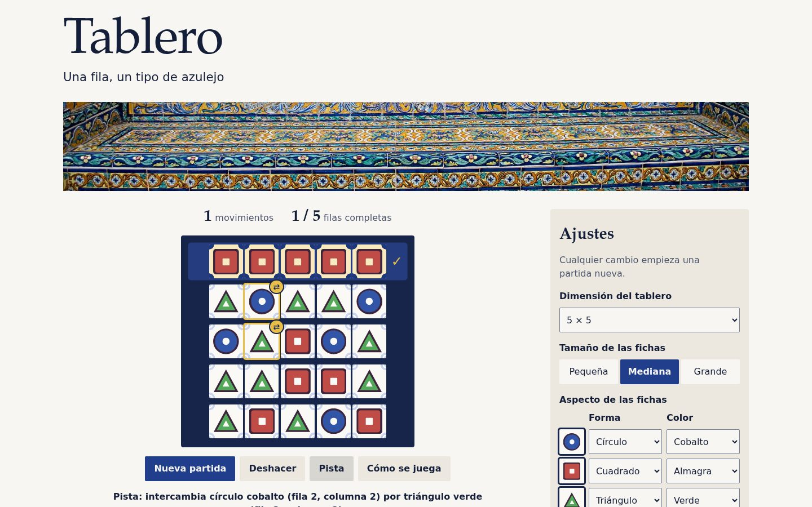

# Proyecto Tablero

[Probar en línea](https://ipo-2627-dinamarca.github.io/ipo2627_dinamarca_tablero/)



El proyecto consiste en una aplicación que implementa un juego de fichas dispuestas en un tablero.

# Objetivos

El proyecto será una aplicación web usando HTML, CSS y JS nativos, sin bibliotecas ni frameworks auxiliares.

Los objetivos del proyecto son: 
- Composición apoyándada en Flexbox & Grid
- Interacción mediante la API `Drag & Drop` (y `dataTransfer`) para el movimiento de fichas. 
- Selección desde JS de elementos HTML mediante atributos `data-*`
- Posicionamiento `position` para el diseño de la asistencia al usuario


# Descripción

El sistema interactúa con un único actor que es el usuario encargado de jugar al juego. 

El tablero donde se practica el juego es una estructura cuadrada NxN con N>=3. En cada celda del tablero se muestra una única ficha, teniendo en cuenta que existen 3 tipos de fichas distinguibles por su forma y color. 

El sistema permitirá al jugador realizar las siguientes acciones:
- Comenzar una nueva partida (tablero inicial)
- Cambiar la dimensión N (con N>=3) del tablero NxN 
- Cambiar el tamaño de las fichas, admitiendo tres magnitudes: pequeña, mediana y grande.
- Modificar el aspecto - forma y color - de las fichas. Por ejemplo: las fichas podrían ser círculos, cuadrados, triángulos, etc.
- Obtener información sobre la mecánica del juego. 


La modificación de las características del tablero o las fichas supondrá la creación de un nuevo tablero de partida. 

La mecánica del juego es la siguiente:
- Comienzo: el tablero de partida consiste en una distribución de fichas aleatorias teniendo en cuenta que las fichas seleccionadas permita que el juego pueda concluir.
- Movimiento: el jugador podrá intercambiar las fichas situadas en dos celdas. 
- Fin: el tablero se completa cuando cada una de las filas del tablero contiene fichas del mismo tipo.


# Diseño

- La aplicación deberá estar implementada siguiendo un patrón MVC (_Model-View-Controller_) con objeto de clarificar y diferenciar las distintas responsabilidades. 
- Tanto la distribución del código de los ficheros como la propia organización de los ficheros incluidos en la carpeta del proyecto deberán facilitar la comprensión y el mantenimiento de la solución aportada. 


## Interacción 

La implementación de la interacción estará guiada para favorecer la usabilidad de la aplicación.

# Buenas prácticas HTML/CSS/JS

- Vinculación moderna de los componentes HTML, CSS y JS
- Etiquetado HTML semántico y moderno. 
- Estrategia de selectores CSS mantenible.
- Selección de composiciones apropiadas (unidimensional, bidmiensional)
- Aplicación justificada del posicionamiento. 
- Separación clara y organizada de los distintos aspectos estilísticos considerados: diseño cromático, tipográfico y espacial. Y cada uno estará cimentado en una sólida estrategia:
  - diseño cromático: monocromático, triádico, complementario, etc.
  - diseño tipográfico: dos fuentes contrastadas, una única fuente con niveles distintos de realce, etc.
  - diseño espacial: selección de unidades de medida y contenedores, principios de diseño `Gestalt`, etc. 


# Solución

La aplicación usa solo HTML, CSS y JavaScript del navegador. Para probarla hay que servir la carpeta con un servidor local (Live Server, `python3 -m http.server`...), porque los módulos de JS no cargan si se abre el archivo directamente.

## Estructura

```
index.html                estructura de la página y los dos diálogos
DESIGN.md                 dirección de arte: concepto, color, tipografía, espacio y componentes
img/
  favicon.svg             icono: paño con tres filas de azulejos, cada una de un tipo
  zocalo-plaza-espana.jpg zócalo de la Plaza de España, foto con licencia CC BY-SA 4.0
css/
  tokens.css              orden de capas, propiedades registradas y variables (cromático, tipográfico, espacial)
  base.css                reinicio, foco visible, enlace de salto y utilidades (hidden, solo-lector)
  layout.css              reparto de la página con Grid
  components.css          panel, barra de acciones, paño, azulejos, motivos, cenefa, victoria y diálogos
js/
  main.js                 punto de entrada: crea modelo, vistas y controlador
  model/
    constantes.js         tipos, límites de dimensión y claves de tamaños, formas y colores
    partida.js            Partida y repartoOptimo (la pista)
    configuracion.js      ajustes validados y guardados
    records.js            mejor marca por dimensión
    almacen.js            lectura y escritura en localStorage
  view/
    dom.js                $, $$ y aplicarAspecto, compartidos por las vistas
    textos.js             nombres visibles de formas y colores
    vistaTablero.js       rejilla, arrastre, clics, teclado y capa de victoria
    vistaControles.js     ajustes, barra de acciones, marcador, mensajes y diálogos
  controller/
    controlador.js        estado de la interacción y reglas de cada acción
```

## Arquitectura MVC

`Partida` guarda el tablero como un array de N×N tipos (0, 1 o 2). Genera el reparto inicial, intercambia fichas, deshace con una pila de pares `[a, b]` (el número de movimientos es el tamaño de la pila), detecta las filas completas y calcula la pista. `Configuracion` guarda la dimensión, el tamaño y el aspecto de cada tipo con claves neutras (`circulo`, `tono-3`...), y `Records` guarda el menor número de movimientos de cada dimensión. Ninguna de las tres toca el DOM. Las dos últimas leen de `localStorage` y comprueban los datos contra listas cerradas; si algo no encaja, se usan los valores por defecto.

Las vistas son las únicas que tocan el DOM y avisan al controlador mediante callbacks (`alSeleccionar`, `alIntercambiar`, `alRevancha`, `alCambiarAjuste`, `alPulsarAccion`...). También ponen los nombres visibles de las fichas («estrella cobalto»), que están en `view/textos.js`. El controlador guarda la ficha seleccionada y la pista, pide los cambios al modelo y dice a cada vista qué mostrar. Cuando necesita el nombre de una ficha para un mensaje, se lo pide a la vista.

## Mecánica del juego

- Comienzo: de cada tipo hay fichas justas para llenar filas enteras (un múltiplo de N), y las N filas se reparten entre los tres tipos lo más igualadas posible. Se barajan con Fisher-Yates hasta que ninguna fila empiece completa, así que el tablero siempre tiene solución.
- Movimiento: se intercambian dos fichas de distinto tipo, estén donde estén. Cambiar dos iguales no serviría de nada, así que la interfaz no lo permite: no se puede soltar una ficha sobre otra igual, y si se pulsa una del mismo tipo que la seleccionada, la selección pasa a esa.
- Fin: cuando todas las filas tienen un único tipo aparece una tarjeta con los movimientos y el récord de esa dimensión.
- Ajustes: dimensión de 3×3 a 9×9 (con más, las celdas serían demasiado pequeñas en un móvil), fichas pequeñas, medianas o grandes, y forma y color de cada tipo entre seis formas y seis colores. Si se elige una forma o un color que ya tiene otro tipo, los dos se lo intercambian para que los tipos sigan distinguiéndose. Cualquier cambio empieza una partida nueva.

### Pista

Primero se decide qué tipo debe acabar en cada fila. De todos los repartos que respetan cuántas filas le tocan a cada tipo, `repartoOptimo` elige el que deja más fichas ya en su sitio. Lo resuelve con programación dinámica: el estado es la fila por la que va y cuántas filas le quedan a cada tipo, así que hay muy pocos estados incluso en un 9×9. Con ese reparto se busca un intercambio entre dos fichas mal colocadas que deje bien las dos a la vez; si no lo hay, uno que coloque al menos una.

La pista nunca mueve una ficha que ya está en su sitio. Por eso cada pista aumenta el número de fichas bien colocadas, y seguir las pistas siempre termina la partida.

## Composición y posicionamiento

- Grid para lo bidimensional: la página, con áreas con nombre, el tablero, las filas de aspecto del panel y la barra de acciones cuando hay poco ancho (2 × 2). Bajo la cabecera, la foto del zócalo ocupa una banda de lado a lado de la página (las dos columnas), con un alto fluido entre 6 y 10 rem y recortada con `object-fit: cover`; debajo van el juego y los ajustes. En una columna el orden es cabecera, zócalo, juego y ajustes, y la banda baja a 4,5 rem y llega hasta los bordes de la pantalla, para que el tablero y la barra de acciones sigan cabiendo en la primera pantalla de un móvil. Siempre se sigue el orden del HTML, que es también el del tabulador.
- El tablero tiene N columnas entre dos medias columnas: la de la derecha es para la marca ✓ y la de la izquierda la equilibra (es el `::before` de cada fila), así las fichas quedan centradas. Cuando el área de juego mide menos de 26 rem, el marco reduce su relleno y las medias columnas pasan de media celda a 0,35, y ese ancho recuperado va a las fichas (en un 9 × 9 a 320 px la celda gana un 10 %). Cada fila usa `grid-template-columns: subgrid`, de modo que comparte las columnas del tablero y, cuando está completa, se pinta como un filete de cobalto continuo sobre el paño.
- Flexbox para lo unidimensional: cabecera, marcador, barra de acciones en pantalla ancha, control segmentado, tarjeta de victoria y diálogos.
- `position` para la asistencia al usuario, que se superpone sin desplazar nada: la insignia ⇄ en la esquina de las celdas de la pista o de destino (`::after` sobre la celda `relative`), las esquinas de la cenefa en las filas completas (`::before` absoluto sobre la misma celda), la capa de victoria sobre el tablero (absoluta dentro del marco `relative`) y el enlace «Saltar al tablero». También la usa la utilidad `.solo-lector`, que oculta textos que solo deben leer los lectores de pantalla.
- El área de juego y el panel son contenedores de consulta con nombre (`container: juego / inline-size`). La celda mide lo que marca el tamaño elegido salvo que no quepa, y entonces se ajusta al ancho con `cqi`. Por eso en un móvil «mediana» y «grande» se ven iguales en tableros grandes: las dos llegan al máximo que permite el ancho. En el panel, forma y color van en dos columnas cuando el panel mide al menos 22rem; con menos se apilan, para que ningún nombre se corte. Por debajo de 48rem la página pasa a una columna, porque con el panel al lado el marcador ya no cabría en una línea.

## Estilística

Cada estrategia tiene su bloque en `css/tokens.css`, y el resto de hojas solo usa esas variables: colores, fuentes, escala tipográfica, espacios, radios, tamaños de celda, capas y duraciones.

### Cromática

La idea de partida es la azulejería sevillana: cada ficha es un azulejo, el tablero es un paño de pared y una fila completa se convierte en cenefa. Los colores salen de ese material. Las variables llevan el nombre del esquema al que pertenecen, como se recomienda en teoría:

- `--comp-*`: la interfaz sigue un esquema complementario. Se fija un matiz, el azul cobalto (`--comp-matiz: 224`), y su opuesto se calcula con `--comp-opuesto: calc(var(--comp-matiz) + 180)`, que da el ocre melado. Son los dos colores que dominan la Plaza de España y la foto del zócalo. Cada uno tiene un papel fijo para que el color también informe: el cobalto es la acción (botón principal, opción marcada, foco, selección) y el ocre es la ayuda y el logro (pista, destino del arrastre, ✓ y cenefa). Los neutros tampoco son grises: el fondo es el ocre casi sin saturación (blanco de estaño) y la tinta es el cobalto muy oscuro. El modo claro y el oscuro se resuelven con `light-dark()`. Los textos cumplen el nivel AA y el borde de los desplegables, 3:1.
- `--triada-1` a `--triada-6`: las fichas usan dos tríadas intercaladas, una girada 60° respecto a la otra, y entre las dos dan seis matices repartidos cada 60° empezando por el cobalto. Cada uno cae en un esmalte real (cobalto, manganeso, almagra, ocre, verde de cobre y turquesa). Por defecto se usa una sola tríada, la de los tipos 1, 3 y 5, y la otra solo aparece si el jugador cambia los colores en los ajustes. Se definen en `oklch` a partir de `--triada-matiz: 265`; si el navegador no lo admite, se aplican respaldos HSL calculados desde `--comp-matiz` sumando 60° cada vez (`@supports`). El 224 de HSL y el 265 de `oklch` son el mismo cobalto expresado en dos espacios de color distintos, así que la ficha cobalto y los botones de la interfaz comparten matiz.

El tablero es un paño oscuro con piezas claras en los dos modos, porque así es un azulejo de verdad y porque es lo único oscuro y saturado de la página: es lo primero que se mira (figura y fondo). En modo oscuro el azulejo baja un poco su luz para no deslumbrar. Cada esmalte tiene su propia luz, como en la cerámica, así que en escala de grises las fichas también se distinguen por lo claras u oscuras que son. La forma sigue siendo lo que identifica el tipo y el color la refuerza. Las fichas claras (ocre, turquesa, verde) no llegan a 3:1 contra el blanco del azulejo, y por eso todos los motivos llevan un contorno de cuerda seca de manganeso oscuro, la línea que separa los esmaltes en la técnica de ese nombre. Con él cualquier ficha pasa de 9:1 sobre cualquier vidriado.

### Tipográfica

Dos fuentes contrastadas, las dos del sistema y con una pila de respaldo, para no descargar nada. Los rótulos (el título, «Ajustes», los títulos de los diálogos y de la victoria y las cifras del marcador) van en una serifa antigua, como la letra de las cartelas de la Plaza de España: Iowan Old Style, Palatino o sus clones libres (URW Palladio, P052). Ninguna de ellas está en todos los sistemas; por eso la pila acaba en la serifa genérica, y el diseño aguanta con cualquiera. Todo lo demás va en la palo seco del sistema. La serifa da el carácter y la palo seco se lee mejor a tamaño pequeño; el contraste entre las dos marca la jerarquía.

Los tamaños salen de una escala modular de razón 4:3 (`--razon: 1.333`) calculada con `pow()`, y en toda la página solo hay cinco: 14 px para el pie, 16 px para todo el texto, 21 px para el lema, 28 px para los rótulos medianos y un título fluido con `clamp()` que va de 51 a 90 px. La única excepción es la ✓ de las filas completas, que se mide con la celda (`calc(var(--celda) * 0.4)`) y no con la escala, para que crezca y mengüe con el tablero. No hay etiquetas en mayúsculas espaciadas: el marcador pone la cifra delante de la palabra («12 movimientos»), con cifras tabulares para que no bailen. También hay `text-wrap: balance` en los títulos, `pretty` en los párrafos y unos 60 caracteres como ancho máximo de lectura.

### Espacial

Unidades `rem` con una escala doble de espaciado (0,25 → 0,5 → 1 → 2 → 4 rem), `cqi` para ajustar la celda al ancho del área de juego y porcentajes dentro de la ficha. Los radios son los de un azulejo, de arista casi viva: 2 px en celdas, botones y campos, y 4 px en el marco, el panel y los diálogos. En el tablero las juntas son proporcionales a la celda, y las horizontales miden el triple que las verticales porque el juego va por filas.

Principios de la Gestalt:

- Figura y fondo: piezas blancas sobre un paño de cobalto. El fondo del paño se ve por las juntas, así que la rejilla se dibuja sola, sin líneas. Cada azulejo lleva en las esquinas un lazo de cobalto muy pálido (un punto y un cuarto de anillo) que queda por debajo de la ficha: da textura de cerámica sin competir con el contorno de cuerda seca.
- Proximidad: las juntas horizontales, más anchas, hacen que cada fila se lea como una unidad.
- Semejanza: mismo tipo, misma forma, color y luz.
- Región común: la fila completa se apoya en un filete de cobalto más claro, el panel es un campo de color sin borde y la tarjeta de victoria va enmarcada.
- Cierre y continuidad: los lazos de cuatro piezas vecinas se leen como una roseta partida por las juntas, igual que en los azulejos de repetición. En la cenefa el lazo desaparece y cada azulejo pinta en sus esquinas un cuarto de círculo de cobalto intenso, que con los vecinos forma una fila de círculos: la fila se lee como un friso continuo y no se confunde con el resto del paño.

Botones y controles miden al menos 44 px de alto para poder pulsarlos con el dedo.

## Interacción y usabilidad

- Arrastrar y soltar con la API nativa. En `dragstart` el índice de la celda de origen viaja en `dataTransfer` (`application/json`), y la imagen que se arrastra es la propia forma, centrada en el puntero (`setDragImage`). `dragenter` y `dragover` solo aceptan el soltado sobre una ficha de otro tipo del mismo tablero, así que el cursor ya indica dónde no se puede soltar. En `drop` se comprueba que el origen recibido coincide con la celda que empezó el arrastre. Mientras se arrastra, el origen queda con un contorno discontinuo de cobalto y la ficha atenuada, y el destino con un anillo ocre e insignia ⇄.
- Toda la celda se puede pulsar y arrastrar. La forma se dibuja en un elemento interior que no recibe eventos, de modo que una estrella o un triángulo responden igual que un cuadrado (ley de Fitts).
- Clic o toque en una ficha y después en otra. Al seleccionar, el azulejo pasa a un vidriado azul pálido con un anillo interior de cobalto y la ficha crece, y las del mismo tipo se atenúan para que se vea con cuáles se puede cambiar. El foco del teclado es un anillo blanco por fuera, sobre el paño, así que nunca se confunde con la selección.
- Teclado: flechas para moverse por el tablero, Inicio y Fin para ir al principio o al final de la fila, Ctrl+Inicio y Ctrl+Fin para las esquinas, Intro o Espacio para elegir, Esc para cancelar y Ctrl+Z (Cmd+Z en Mac) para deshacer. Con el tabulador se entra y se sale del tablero de una vez.
- Control y libertad: Deshacer revierte el último intercambio y se puede repetir hasta el principio de la partida. «Nueva partida» y los cambios de ajustes piden confirmación en un `<dialog>` si hay movimientos, con el foco en «Seguir jugando»; si se cancela, el control vuelve a su valor. Los ajustes se aplican cuando se deja de cambiar el control o se sale de él, porque con las flechas un desplegable cambia de valor a cada pulsación y crearía partidas intermedias.
- Estado visible: marcador de movimientos y filas completas, ✓ y cenefa en las filas completas, un mensaje que explica cada acción y la barra de acciones justo debajo del tablero (en el móvil queda a la vista sin desplazarse y el panel solo tiene ajustes). Las instrucciones cambian con `@media (pointer: coarse)`: en pantallas táctiles solo explican cómo jugar tocando.
- Movimiento: si el sistema no pide reducir animaciones (`prefers-reduced-motion`), las dos fichas intercambiadas se deslizan hasta su nuevo sitio en 180 ms y cuando una fila se completa sus esquinas se enlazan en cenefa de izquierda a derecha. El deslizamiento usa la técnica FLIP con la Web Animations API, que a diferencia de las View Transitions no bloquea los clics mientras dura. Con la misma condición, botones y opciones cambian de color con una transición corta, la ficha crece poco a poco al pasar el ratón y la tarjeta de victoria y los diálogos entran con un fundido. En los navegadores que admiten `transition-behavior: allow-discrete`, los diálogos también se desvanecen al cerrarse; en el resto se cierran sin más. Al pulsar un botón, este baja 1 px, como una tecla; eso ocurre siempre, porque no es una animación.
- Victoria: una tarjeta sobre un velo ligero con los movimientos, el récord de la dimensión y el foco en «Jugar otra vez». En tableros medianos y grandes se sigue viendo el tablero resuelto alrededor; en un 3×3 pequeño la tarjeta lo tapa casi entero. El tablero queda inactivo (`inert`).
- Accesibilidad: el tablero tiene los roles `grid`, `row` y `gridcell`, y cada celda dice qué ficha tiene y dónde («triángulo verde, fila 2, columna 3») y si está seleccionada (`aria-selected`). Los mensajes se anuncian en una región `role="status"`. La ayuda es un `<dialog>` con botón de cerrar.

## Recursos de CSS

- Capas (`@layer tokens, base, layout, componentes, utilidades`), declaradas una sola vez: el orden de las capas decide qué regla gana, así que no hace falta ningún `!important`.
- Clases con nomenclatura BEM y sin ids; el anidamiento nativo solo se usa para los estados (`&:focus-visible`, `&.celda--seleccionada`), y todas las medidas usan propiedades lógicas (`inline-size`, `margin-inline`...).
- Los estados de la celda se combinan con dos variables, `--anillo-dentro` y `--anillo-fuera`, que una única regla `box-shadow` compone. Así una celda puede estar a la vez seleccionada y en la pista sin reglas especiales para cada combinación.
- Cada motivo se dibuja en tres capas recortadas con la misma silueta, guardada en `--motivo`: el contorno de cuerda seca (la ficha), el esmalte (`::before`) y un «ojo» central con el color del vidriado (`::after`), que repite la forma en pequeño. Para que el contorno tenga el mismo grosor en las seis formas, el esmalte se escala desde el incentro con `1 − cuerda / apotema`, donde la apotema es la distancia del centro a los lados de cada forma.
- El retardo escalonado de la cenefa usa `sibling-index()` como mejora progresiva. Va en su propia declaración: si el navegador no la entiende, descarta solo esa línea y la cenefa aparece entera de una vez.
- `@property` registra `--n` como entero y `--celda` como longitud. El navegador descarta un valor de `--n` que no sea entero, y el tamaño de la celda se calcula en el tablero y se hereda ya resuelto.
- `forced-colors`: en el modo de alto contraste de Windows el tablero y las muestras conservan sus colores, porque el color de las fichas es información, y la opción marcada del control segmentado se pinta con el color de resaltado del sistema. Como los botones y las opciones no tienen borde propio, en ese modo reciben uno de `ButtonText` para no perder su caja.
- `prefers-contrast: more`: si el usuario pide más contraste, el texto secundario y los bordes pasan a la tinta plena, los anillos de foco y selección se engrosan y la cuerda seca de las fichas también.
- El *hover* solo existe en `(hover: hover)`, para que en pantallas táctiles no se quede marcado tras tocar.
- `@starting-style` fija desde dónde empieza la transición de un elemento que pasa de `display: none` a visible: la capa de victoria y los diálogos. En los diálogos, `display` y `overlay` llevan `allow-discrete`, que los mantiene en la capa superior hasta que acaba el fundido de salida.
- `scrollbar-gutter: stable` reserva el hueco de la barra de desplazamiento. Así la página no se mueve hacia un lado cuando un diálogo abierto bloquea el desplazamiento.
- `overscroll-behavior: contain` en los diálogos: al llegar al final de su texto en el móvil, el gesto no sigue desplazando la página de debajo.

## Buenas prácticas

- HTML semántico: `header`, `main` (con un `h2` solo para lectores de pantalla), `aside` para los ajustes y `footer`; un único `h1`; los ajustes en un `form` con `fieldset`, `legend` y `label`; el marcador como lista de definiciones; dos `dialog`; `theme-color` para modo claro y oscuro y un favicon SVG propio.
- Imagen: la foto del zócalo lleva `width` y `height`, así que el navegador le reserva el sitio y la página no salta al cargarla, `decoding="async"` y un `alt` que describe lo que se ve. El crédito y la licencia están en el pie.
- JS y DOM: las vistas localizan los elementos por `data-vista`, `data-control`, `data-accion`, `data-celda` y `data-tipo` (las clases quedan para el estilo), y atienden los eventos por delegación en el tablero, el formulario y la barra de acciones.
- JS y estilos: el JS no escribe estilos sueltos. Solo fija `--n`, cambia clases modificadoras y lanza la animación del intercambio; colores y medidas vienen del CSS.

## Créditos

La foto del zócalo es «Banco caceres plaza españa 2018001», de [Anual](https://commons.wikimedia.org/wiki/User:Anual) (4 de enero de 2018), publicada en [Wikimedia Commons](https://commons.wikimedia.org/wiki/File:Banco_caceres_plaza_espa%C3%B1a_2018001.jpg) con licencia [CC BY-SA 4.0](https://creativecommons.org/licenses/by-sa/4.0/deed.es). Está recortada a la franja inferior del banco y reducida a 1440 px de ancho. Como es una obra derivada, `img/zocalo-plaza-espana.jpg` se comparte con la misma licencia; el resto del proyecto no se ve afectado.
